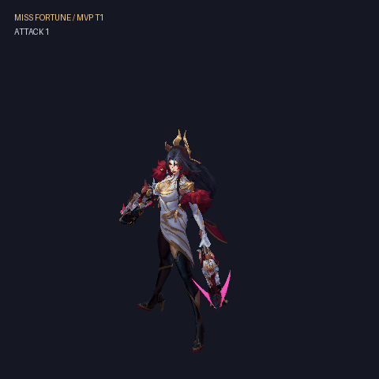

# T1 MVP Miss Fortune · Skin69

Developer assets for the MF 0.5.46+ port. Open the GIF to see an attack and run from the Isaac camera angle. The GLB can be opened directly in a glTF viewer to inspect individual clips, materials and joints.

## Asset correspondence

- The two supplied ZIPs together cover all 328 SHA-256 entries in `source-manifest.json`. The model, animation graph, textures and sound design originate with Riot Games. The mesh was converted with TFOS4 HeroStudio.
- `conversion.json` maps source ANM filenames to GLB animations. `animation-events.json` records source frame boundaries, particle attachments and visibility events. The conversion uses original transform tracks. The GLB viewer needs to apply the submesh visibility and joint attachment rules when playing a clip.
- `rig-inventory.json` describes the complete skeleton, influence map and weapon attachments. The two muzzle attachments are joints 119 and 164. Both must be sampled even though neither deforms vertices. The preview explicitly selects the handheld Gun23 set and omits combat particles.
- All 24 mesh materials in the GLB have a base color texture. Three additional diffuse PNGs (Gun23 Gold, Gun24 Gold and Ribbom) were retrieved from [CommunityDragon](https://raw.communitydragon.org/16.22/game/assets/characters/missfortune/skins/skin69/). These PNGs are byte-identical across patches 16.22 and 16.23. Material blending, scroll masks and live VFX still need validation against the game.
- `audio/` holds the original SFX banks and English VO banks. Riot manifest, virtual paths and hashes are recorded in `audio/riot-provenance.json`. The supplied SFX event bank and WPK match the corresponding CDN files by SHA-256.
- Gameplay integration and REPENTOGON playtesting require the author's current `miss-fortune-local` source. This directory is for import into that project.

Third-party assets retain their original rights. [HeroStudio](https://github.com/TFOS4/Isaac-LoL-HeroStudio)

## Rebuild the model

Use Python with cdtb, Pillow, NumPy and xxhash, and the app folder from HeroStudio 0.2.33. Run `python build_model.py PATH_TO_EMPTY_FOLDER --studio-app PATH_TO_HEROSTUDIO_APP`. The output is `assets/preview/base.glb` inside the selected folder.

The supplied graph references 52 unique clips. Of these, 38 came from the supplied archives and 14 from Riot WAD path lookups. All 38 overlapping clips matched by SHA-256. The supplied animation graph matches patch 16.14. The independent version comparison for the other 14 clips covers asset names and graph references only. The full model rebuilt from an empty directory has SHA-256 `64a30bd81e0d596b62b8130048394a063c715be7d4d965ed7dd8b3179f9e9163`.

Individual decoded sounds are included under `audio/wav/`. The Wwise event mappings in `audio/manifest.json` describe sample selection. Playback in the mod still needs its timing, sound mixing and game checks.
