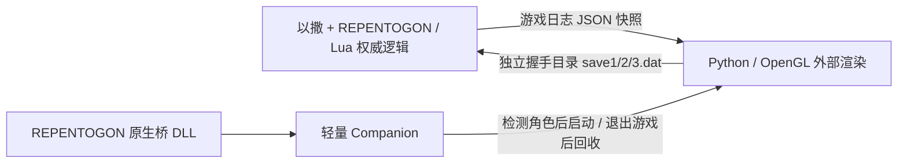

# 架构、运行时和身份

DLL 导出 `ModInit`，在工作线程启动 Companion；不在 `DllMain` 等待，不改游戏 EXE，不注入渲染钩子。Companion 只等待当前游戏进程的退出信号、读取日志和管理自己启动的子进程。

## 数据流

`mod/scripts/<id>_external.lua` 发出以 `[<ID>_EXTERNAL] ` 开头的 JSON。`external/bridge.py` 限量读取、验证基础字段、插值连续快照。当前协议 `version=1`、`companionProtocol=1`。

| 字段 | 含义 |
|---|---|
| `active`, `seq`, `time`, `clock` | 活跃角色、顺序、引擎毫秒时间、30 Hz 逻辑时钟 |
| `session`, `room` | 绘制所有权与房间标识；不能把旧会话确认用于新会话 |
| `screen`, `position`, `face`, `bodyScale` | 客户区逻辑坐标、角色脚点、朝向、体型 |
| `kind`, `phase`, `clip`, `cast` | 动作选择、归一化进度、原始片段名、施法时序 |
| `transition`, `occluded`, `paused`, `hudVisible`, `renderCaptured` | 场景遮挡和 HUD/人物分层；不要压缩成一个“显示”布尔值 |
| `hud`, `shop` | Lua 计算的生命、经验、冷却、装备、商店数据 |
| `fx`, `hits`, `bolt`, `chain`, `r` | 现有剑魔特效载荷；新英雄须定义对应数据 |

外部渲染确认写入 `<game>/data/<id>_external_link/save1.dat` 等文件。Lua 用 `Isaac.LoadModDataFromFolder` 读取，校验会话、时效、能力和绘制状态。握手文件不保存英雄进度。无渲染能力或超时后，保留游戏内 fallback。

`external/visibility.py` 决定人物与 HUD 是否绘制；`overlay.py` 持有透明窗口和 GPU 对象；`status.py` 提交绘制确认。三者的时序需作为整体维护。

## 身份隔离

生成器更新 Mod directory/注册名、脚本模块名、数据键、gfx/sfx 根目录、音效/音乐注册名、角色菜单动画名、控制台前缀、协议日志前缀、状态目录、DLL、INI、安装器 app 和 Windows 互斥锁。

仍保留原样的东西：原版 GLB 内动画名、粒子资源键、模型内部纹理名、素材出处以及示例技能内容。`aatrox_ground_q2` 是动画资源名，不是 Mod 身份。

现在外部接管以单玩家为前提，代码中有 `GetNumPlayers()==1` 判断。多个独立分支不会自动变成多英雄宿主；勿宣称联机兼容。Windows + REPENTOGON x86 + Python/OpenGL x64 是已使用的平台组合，其他平台需移植验证。
